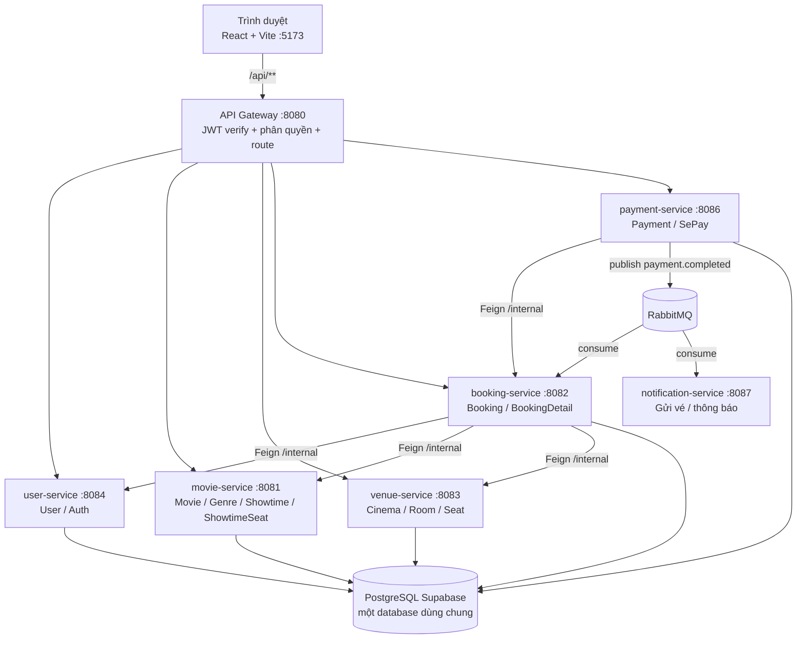
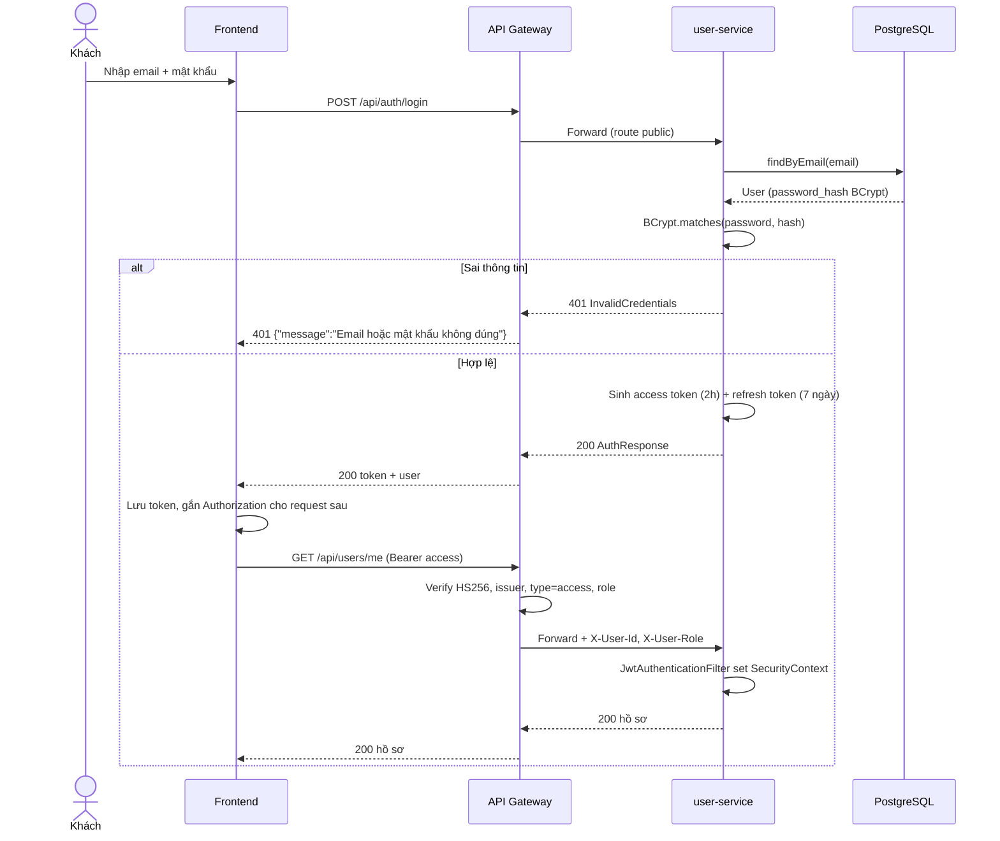
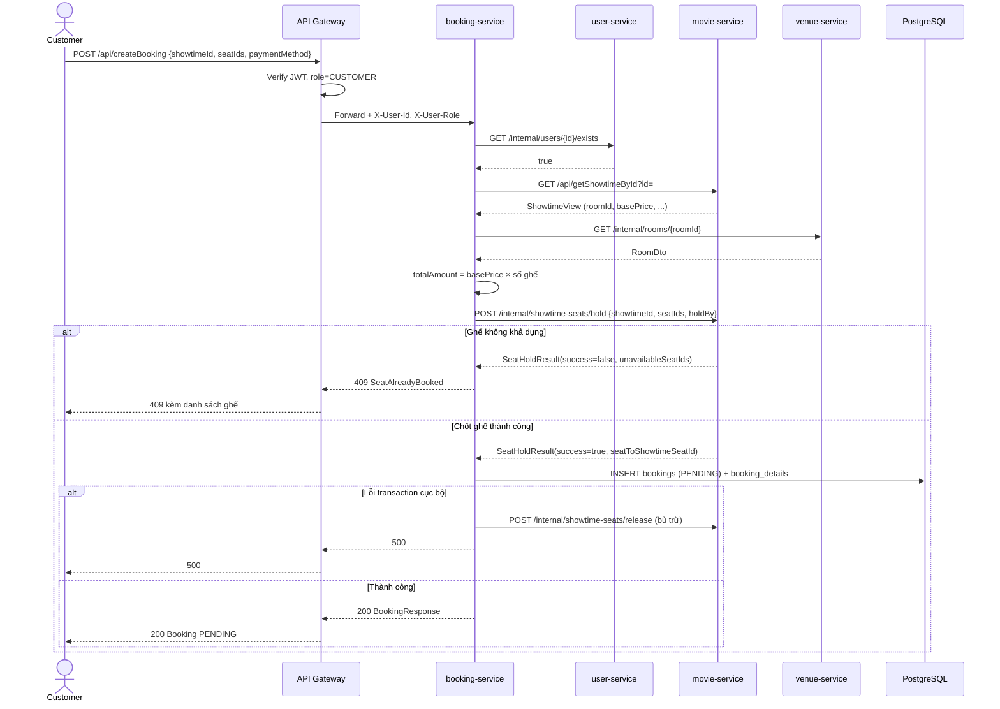
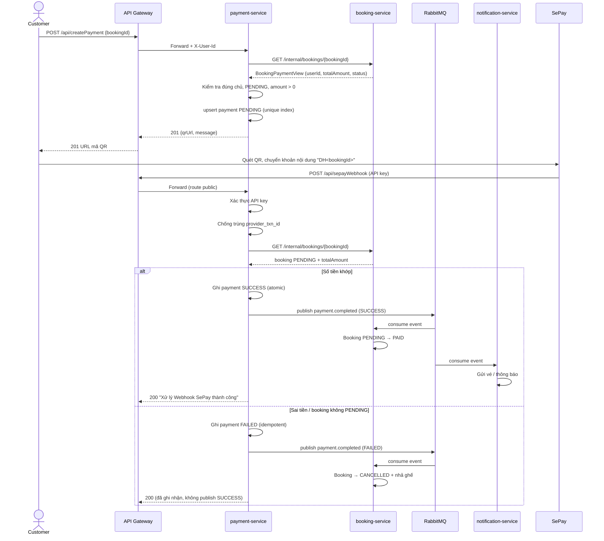
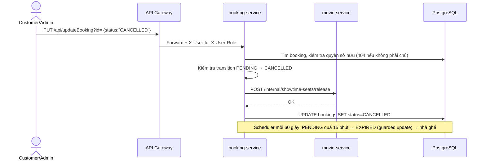
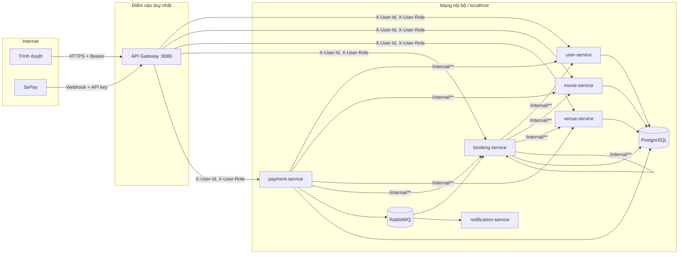

# BÁO CÁO ĐỒ ÁN — HỆ THỐNG ĐẶT VÉ XEM PHIM TRỰC TUYẾN

> Phạm vi tài liệu: Chương 1 (giới thiệu & kiến trúc), Chương 2 (thiết kế API & giao tiếp), Chương 4 (xác thực & bảo mật). Chương 3 (quản lý dữ liệu) không thuộc phạm vi yêu cầu.

---

## Chương 1. Giới thiệu đề tài và kiến trúc dịch vụ

### 1.1. Bài toán

Rạp phim hiện bán vé theo cách thủ công: khách đến quầy chọn suất chiếu, nhân viên kiểm tra ghế trống trên sơ đồ giấy hoặc phần mềm cục bộ, thu tiền rồi in vé. Cách làm này có các vấn đề:

- Không có kênh đặt vé trực tuyến, khách phải đến rạp hoặc gọi điện.
- Khó đồng bộ trạng thái ghế giữa nhiều quầy: hai khách có thể cùng chọn một ghế.
- Không có cơ chế giữ ghế tạm thời trong lúc khách thanh toán.
- Thanh toán và xác nhận vé tách rời, dễ sai lệch doanh thu.
- Quản trị phim, suất chiếu, rạp, phòng, ghế phân tán, không có một nguồn dữ liệu thống nhất.

Hệ thống **Movie Ticket Booking System** giải quyết các vấn đề trên bằng một nền tảng web cho phép khách hàng duyệt phim, xem lịch chiếu, chọn ghế theo thời gian thực, giữ ghế tạm thời, thanh toán qua mã QR và nhận xác nhận vé; đồng thời cung cấp giao diện quản trị cho phim, thể loại, suất chiếu, rạp, phòng, ghế, người dùng và thống kê doanh thu.

**Tác nhân (actor):**

| Tác nhân | Quyền hạn chính |
| --- | --- |
| Khách (chưa đăng nhập) | Xem phim, thể loại, suất chiếu, rạp, phòng, ghế, sơ đồ ghế |
| CUSTOMER | Đăng ký/đăng nhập, cập nhật hồ sơ, giữ/nhả ghế, đặt vé, thanh toán, xem vé của mình, huỷ vé đang chờ |
| ADMIN | Toàn bộ quyền quản trị CRUD phim/thể loại/suất chiếu/rạp/phòng/ghế/người dùng; xem toàn bộ booking, thống kê doanh thu; xem/ cập nhật/ xoá booking |

### 1.2. Kiến trúc tổng quan

Hệ thống theo kiến trúc hướng dịch vụ (**SOA**): một **API Gateway** duy nhất nhận request từ frontend, xác thực JWT và định tuyến đến **7 service Spring Boot độc lập**. Các service giao tiếp với nhau qua **REST đồng bộ (OpenFeign)** cho truy vấn nghiệp vụ và **RabbitMQ (bất đồng bộ)** cho sự kiện thanh toán.



**Quy ước quan trọng:**

- Endpoint công khai/quản trị dùng dạng **verb-path** dưới `/api/**` (ví dụ `POST /api/createBooking`).
- Endpoint nội bộ dùng `/internal/**`; gateway **không** định tuyến các path này và các service backend bind `127.0.0.1`, nên chỉ gọi được từ trong máy chủ.
- Gateway gắn `X-User-Id`, `X-User-Role` sau khi xác thực; service nghiệp vụ tin các header này và không tin `userId`/`role` do client gửi trong body/query.
- Không có service discovery/registry; địa chỉ service lấy từ biến môi trường (`USER_SERVICE_URL`, `MOVIE_SERVICE_URL`, ...).

### 1.3. Trách nhiệm nghiệp vụ của từng dịch vụ

| Service | Port | Domain | Trách nhiệm chính | Dữ liệu sở hữu |
| --- | ---: | --- | --- | --- |
| `api-gateway` | 8080 | Edge | Định tuyến `/api/**`, CORS, xác thực JWT, phân quyền theo role, chống bypass bằng chuẩn hoá path, gắn header danh tính nội bộ | Không sở hữu dữ liệu |
| `user-service` | 8084 | User, Auth | Đăng ký (luôn CUSTOMER, mật khẩu BCrypt), đăng nhập, refresh token, hồ sơ cá nhân, CRUD user cho ADMIN, API kiểm tra user tồn tại cho service khác | `users` |
| `movie-service` | 8081 | Movie, Genre, Showtime, ShowtimeSeat | CRUD phim/thể loại/suất chiếu; quản lý tồn kho ghế theo từng suất: giữ tạm (HOLDING 10 phút), nhả, chốt (BOOKED); cung cấp thông tin suất chiếu/ghế nội bộ | `movies`, `genres`, `movie_genres`, `showtimes`, `showtime_seats` |
| `venue-service` | 8083 | Cinema, Room, Seat | CRUD rạp, phòng chiếu, ghế; tra cứu rạp theo thành phố; cung cấp phòng/ghế nội bộ | `cinemas`, `rooms`, `seats` |
| `booking-service` | 8082 | Booking, BookingDetail | Điều phối tạo vé: kiểm tra user → suất chiếu → phòng → chốt ghế → tạo Booking `PENDING` + chi tiết vé; huỷ/ hết hạn và trả ghế; consume `payment.completed` để chuyển `PAID`/`CANCELLED`; thống kê doanh thu | `bookings`, `booking_details` |
| `payment-service` | 8086 | Payment | Tạo QR SePay từ booking hợp lệ, lưu lịch sử giao dịch, xử lý webhook idempotent, đối soát số tiền, publish `payment.completed` | `payments` |
| `notification-service` | 8087 | Notification | Consume `payment.completed`, gửi vé/thông báo cho khách (hiện ghi log) | Không có DB |
| `common` (module) | — | Shared | DTO/event dùng chung (`SeatIdsRequest`, `SeatHoldResult`, `BookingPaymentView`, `PaymentCompletedEvent`), exception và `ApiExceptionHandler` dùng chung | — |

### 1.4. Các luồng nghiệp vụ cốt lõi

**a) Tồn kho ghế phát sinh theo tương tác**

Không tạo sẵn toàn bộ ghế cho mọi suất chiếu. Khi khách thao tác, `showtime_seats` mới sinh bản ghi:

- `POST /api/holdShowtimeSeat` → `HOLDING`, `hold_until = now + 10 phút`, `hold_by = userId`.
- Quá hạn giữ chỗ được coi là trống khi đọc (`resolveStatus`).
- `POST /api/releaseShowtimeSeat` → `AVAILABLE`.
- Khi tạo booking, `movie-service` chốt `HOLDING` (đúng người giữ) hoặc `AVAILABLE` → `BOOKED` bằng một câu SQL có điều kiện, bảo đảm hai người không cùng chốt một ghế.

**b) Đặt vé kiểu Saga-lite**

`booking-service` không dùng một transaction phân tán. Trình tự:

1. Kiểm tra user tồn tại (Feign `user-service`).
2. Đọc suất chiếu (Feign `movie-service`) và phòng chiếu (Feign `venue-service`).
3. Tính `totalAmount` ở server từ `basePrice × số ghế`; client không được gửi `userId`/`totalAmount`.
4. Gọi `movie-service` chốt ghế; nếu có ghế không khả dụng → trả `409`.
5. Tạo `Booking PENDING` + `BookingDetail` trong transaction cục bộ.
6. Nếu bước 5 lỗi → gọi bù trừ nhả ghế.
7. Booking `PENDING` quá 15 phút bị scheduler chuyển `EXPIRED` và nhả ghế; cập nhật có guard để không nhả nhầm đơn đã `PAID`.

**c) Thanh toán và xác nhận vé**

1. Customer gọi `POST /api/createPayment` với `bookingId`.
2. `payment-service` đọc booking qua internal API, kiểm tra đúng chủ sở hữu, đang `PENDING`, số tiền hợp lệ; lưu/ cập nhật payment `PENDING` và trả URL VietQR.
3. SePay gọi webhook khi có biến động số dư.
4. `payment-service` kiểm tra chữ ký/API key, chống trùng theo `provider_txn_id`, kiểm tra booking còn `PENDING`, đối soát số tiền, cập nhật payment `SUCCESS`/`FAILED`, publish `payment.completed`.
5. `booking-service` chuyển booking `PENDING → PAID` (SUCCESS) hoặc `PENDING → CANCELLED` + trả ghế (FAILED). `notification-service` gửi vé khi SUCCESS.

### 1.5. Yêu cầu phi chức năng

| Nhóm | Yêu cầu và cách đáp ứng |
| --- | --- |
| Hiệu năng | Gateway là điểm vào duy nhất; service stateless, có thể nhân bản; các truy vấn ghế dùng câu lệnh có điều kiện thay vì khoá toàn bảng |
| Nhất quán | Ghế được chốt nguyên tử ở `movie-service`; trạng thái booking là nguồn sự thật; bù trừ khi lỗi; webhook idempotent |
| Bảo mật | JWT HS256, BCrypt, phân quyền tại gateway và kiểm tra lại tại service; internal API chỉ bind localhost; secret bắt buộc ≥ 32 ký tự |
| Khả dụng | Lỗi từng service được trả về theo mã HTTP chuẩn; frontend hiển thị lỗi; RabbitMQ tách luồng gửi thông báo khỏi luồng thanh toán |
| Bảo trì | Maven multi-module, module `common` chia sẻ DTO/exception; cấu hình qua biến môi trường; Docker Compose cho môi trường demo |

---

## Chương 2. Thiết kế API và giao tiếp dịch vụ

### 2.1. Quy ước chung

| Hạng mục | Quy ước |
| --- | --- |
| Base URL | `http://localhost:8080/api` (qua gateway) |
| Định dạng | JSON UTF-8; thời gian dùng ISO-8601 (`OffsetDateTime`) |
| Xác thực | `Authorization: Bearer <access_token>` cho endpoint cần đăng nhập |
| Danh tính nội bộ | Gateway gắn `X-User-Id`, `X-User-Role`, `X-Internal-Token`; client gửi các header này sẽ bị ghi đè |
| Tham số | Path cố định dạng verb-path; `id`, `movieId`, `showtimeId`... truyền qua query string; body cho create/update |
| Nội bộ | `/internal/**` không qua gateway, chỉ gọi service-to-service |
| Lỗi | `ErrorResponse {timestamp, status, error, message, path}`; lỗi validation bổ sung `fieldErrors` |
| Mã thành công | `200 OK` (đọc/cập nhật), `201 Created` (tạo mới), `204 No Content` (xoá) |

**Mã lỗi dùng chung:**

| Mã | Trường hợp |
| ---: | --- |
| 400 | Body sai JSON, thiếu field bắt buộc, sai kiểu tham số, thiếu query/header bắt buộc |
| 401 | Thiếu/sai/hết hạn access token; sai email-mật khẩu; refresh token không hợp lệ |
| 403 | Đã xác thực nhưng sai role; dùng header override method |
| 404 | Không tìm thấy tài nguyên; path không khớp rule gateway; truy cập tài nguyên của người khác (che giấu sự tồn tại) |
| 409 | Ghế đã bị giữ/đặt, booking sai trạng thái, vi phạm ràng buộc dữ liệu |
| 500 | Lỗi không xử lý |

### 2.2. Danh sách endpoint

#### 2.2.1. Xác thực và người dùng (`user-service`)

| # | Method | Path | Quyền | Request | Response thành công |
| ---: | --- | --- | --- | --- | --- |
| 1 | POST | `/api/auth/register` | Public | `{fullName, email, password (≥8), phoneNumber?}` | `201` `{id, email, fullName, role}` |
| 2 | POST | `/api/auth/login` | Public | `{email, password}` | `200` `{accessToken, refreshToken, tokenType:"Bearer", expiresIn, user}` |
| 3 | POST | `/api/auth/refresh` | Public | `{refreshToken}` | `200` cặp token mới + `user` |
| 4 | GET | `/api/users/me` | CUSTOMER/ADMIN | — | `200` `{userId, fullName, email, phoneNumber, role}` |
| 5 | PUT | `/api/users/me` | CUSTOMER/ADMIN | `{fullName, phoneNumber?}` | `200` hồ sơ sau cập nhật |
| 6 | GET | `/api/getUsers` | ADMIN | — | `200` danh sách user |
| 7 | GET | `/api/getUserById?id=` | ADMIN | — | `200` user |
| 8 | POST | `/api/createUser` | ADMIN | `{fullName, email, password, phoneNumber?, role}` | `200` user |
| 9 | PUT | `/api/updateUser?id=` | ADMIN | `{fullName?, password?, phoneNumber?, role?}` | `200` user |
| 10 | DELETE | `/api/deleteUser?id=` | ADMIN | — | `200` `"User deleted successfully"` |

**Ví dụ đăng nhập**

```http
POST /api/auth/login
Content-Type: application/json

{ "email": "khach@example.com", "password": "matkhau123" }
```

```json
{
  "accessToken": "eyJhbGciOiJIUzI1NiJ9...",
  "refreshToken": "eyJhbGciOiJIUzI1NiJ9...",
  "tokenType": "Bearer",
  "expiresIn": 7200,
  "user": { "id": 12, "email": "khach@example.com", "fullName": "Nguyễn Văn A", "role": "CUSTOMER" }
}
```

Sai thông tin đăng nhập → `401` `{"message":"Email hoặc mật khẩu không đúng"}` (thông báo chung, không phân biệt email tồn tại hay sai mật khẩu). Email đã tồn tại khi đăng ký → `409`.

#### 2.2.2. Phim và thể loại (`movie-service`)

| # | Method | Path | Quyền | Request | Response |
| ---: | --- | --- | --- | --- | --- |
| 11 | GET | `/api/getMovies` | Public | query: `status?`, `genreIds?`, `title?` | `200` danh sách `MovieResponse` |
| 12 | GET | `/api/searchMovies` | Public | `keyword`, `limit=6` | `200` danh sách phim khớp |
| 13 | GET | `/api/getMovieById?id=` | Public | — | `200` `MovieResponse` |
| 14 | POST | `/api/createMovie` | ADMIN | `MovieRequest` | `201` `MovieResponse` |
| 15 | PUT | `/api/updateMovie?id=` | ADMIN | `MovieRequest` | `200` `MovieResponse` |
| 16 | DELETE | `/api/deleteMovie?id=` | ADMIN | — | `204` |
| 17 | GET | `/api/getGenres` | Public | — | `200` danh sách thể loại |
| 18 | GET | `/api/getGenreById?id=` | Public | — | `200` `{genreId, name}` |
| 19 | POST | `/api/createGenre` | ADMIN | `{name}` | `201` thể loại |
| 20 | PUT | `/api/updateGenre?id=` | ADMIN | `{name}` | `200` thể loại |
| 21 | DELETE | `/api/deleteGenre?id=` | ADMIN | — | `204` |

`MovieRequest`: `{title (bắt buộc, ≤255), description, durationMinutes (>0), language, releaseDate, posterUrl, trailerUrl, ageRestriction, status, director, actors, genreIds[]}`.

`MovieResponse`: `{movieId, title, description, durationMinutes, language, releaseDate, posterUrl, trailerUrl, ageRestriction, status, director, actors, genres[], createdAt, updatedAt}`.

#### 2.2.3. Suất chiếu và ghế theo suất (`movie-service`)

| # | Method | Path | Quyền | Request | Response |
| ---: | --- | --- | --- | --- | --- |
| 22 | GET | `/api/getShowtimes` | Public | query: `movieId?` | `200` danh sách suất chiếu |
| 23 | GET | `/api/getShowtimeById?id=` | Public | — | `200` `ShowtimeResponse` |
| 24 | GET | `/api/getShowtimeSeats?showtimeId=` | Public | — | `200` `ShowtimeSeatView[]` |
| 25 | POST | `/api/holdShowtimeSeat` | CUSTOMER/ADMIN | `{showtimeId, seatId}` | `200` `ShowtimeSeatView` (HOLDING) |
| 26 | POST | `/api/releaseShowtimeSeat` | CUSTOMER/ADMIN | `{showtimeId, seatId}` | `200` `ShowtimeSeatView` (AVAILABLE) |
| 27 | POST | `/api/createShowtime` | ADMIN | `ShowtimeRequest` | `201` `ShowtimeResponse` |
| 28 | PUT | `/api/updateShowtime?id=` | ADMIN | `ShowtimeRequest` | `200` `ShowtimeResponse` |
| 29 | DELETE | `/api/deleteShowtime?id=` | ADMIN | — | `204` |

`ShowtimeRequest`: `{movieId, roomId, startTime, endTime, basePrice (≥0), status?}`.

`ShowtimeSeatView`: `{showtimeSeatId, showtimeId, seatId, seatRow, seatNumber, seatType, status (AVAILABLE|HOLDING|BOOKED), holdUntil}`.

Giữ ghế thất bại (ghế đã `BOOKED`, đang bị người khác giữ, suất chiếu không còn `SCHEDULED`, hoặc đã qua giờ chiếu) → `409`.

#### 2.2.4. Rạp, phòng, ghế (`venue-service`)

| # | Method | Path | Quyền | Request | Response |
| ---: | --- | --- | --- | --- | --- |
| 30 | GET | `/api/getCinemas` | Public | — | `200` danh sách rạp |
| 31 | GET | `/api/getCinemaById?id=` | Public | — | `200` rạp |
| 32 | GET | `/api/getCities` | Public | — | `200` danh sách thành phố |
| 33 | GET | `/api/getCinemasByCity?city=` | Public | — | `200` rạp theo thành phố |
| 34 | POST | `/api/createCinema` | ADMIN | `{name, address, city, phoneNumber?}` | `201` rạp |
| 35 | PUT | `/api/updateCinema?id=` | ADMIN | `CinemaRequest` | `200` rạp |
| 36 | DELETE | `/api/deleteCinema?id=` | ADMIN | — | `204` |
| 37 | GET | `/api/getRooms?cinemaId=` | Public | — | `200` danh sách phòng |
| 38 | GET | `/api/getRoomById?id=` | Public | — | `200` phòng |
| 39 | POST | `/api/createRoom` | ADMIN | `{cinemaId, name, totalSeats (>0), roomType}` | `201` phòng |
| 40 | PUT | `/api/updateRoom?id=` | ADMIN | `RoomRequest` | `200` phòng |
| 41 | DELETE | `/api/deleteRoom?id=` | ADMIN | — | `204` |
| 42 | GET | `/api/getSeatsByRoomId?roomId=` | Public | — | `200` danh sách ghế |
| 43 | GET | `/api/getSeatById?id=` | Public | — | `200` ghế |
| 44 | POST | `/api/createSeat` | ADMIN | `{roomId, seatRow, seatNumber (>0), seatType}` | `201` ghế |
| 45 | PUT | `/api/updateSeat?id=` | ADMIN | `SeatRequest` | `200` ghế |
| 46 | DELETE | `/api/deleteSeat?id=` | ADMIN | — | `204` |

#### 2.2.5. Đặt vé (`booking-service`)

| # | Method | Path | Quyền | Request | Response |
| ---: | --- | --- | --- | --- | --- |
| 47 | GET | `/api/getBookings` | ADMIN | — | `200` toàn bộ booking |
| 48 | GET | `/api/getBookingById?id=` | CUSTOMER/ADMIN | — | `200` booking (customer chỉ thấy của mình) |
| 49 | GET | `/api/getBookingsByUserId?userId=` | CUSTOMER/ADMIN | — | `200` booking của mình; ADMIN truyền `userId` để xem người khác |
| 50 | GET | `/api/getBookingsByShowtimeId?showtimeId=` | ADMIN | — | `200` booking theo suất |
| 51 | GET | `/api/getBookingStats?period=day\|month\|year` | ADMIN | `period` mặc định `day` | `200` `{revenue, paidBookings, ticketsSold, period, revenueSeries[24\|28-31\|12]}` — mỗi kỳ là một đơn vị đang diễn ra (hôm nay / tháng này / năm nay); biểu đồ chia thành giờ / ngày / tháng |
| 52 | POST | `/api/createBooking` | CUSTOMER | `{showtimeId, seatIds[], paymentMethod}` | `200` `BookingResponse` |
| 53 | PUT | `/api/updateBooking?id=` | CUSTOMER/ADMIN | `{status}` | `200` `BookingResponse` |
| 54 | DELETE | `/api/deleteBooking?id=` | CUSTOMER/ADMIN | — | `200` `"Booking deleted successfully"` |

`BookingResponse`: `{bookingId, userId, showtimeId, bookingCode, totalAmount, status, paymentMethod, bookingTime}`.

**Ví dụ tạo booking**

```http
POST /api/createBooking
Authorization: Bearer <access_token>
Content-Type: application/json

{ "showtimeId": 5, "seatIds": [101, 102], "paymentMethod": "SEPAY" }
```

```json
{
  "bookingId": 88,
  "userId": 12,
  "showtimeId": 5,
  "bookingCode": "BK-7F2A9C11",
  "totalAmount": 180000,
  "status": "PENDING",
  "paymentMethod": "SEPAY",
  "bookingTime": "2026-11-04T18:20:31+07:00"
}
```

Quy tắc trạng thái: `PENDING → CANCELLED` (customer/admin), `PENDING → EXPIRED` (admin/scheduler); `PAID` chỉ do listener thanh toán đặt; `PAID/CANCELLED/EXPIRED` là trạng thái cuối. Chuyển sai → `409`; customer cố đặt `EXPIRED` → `403`.

#### 2.2.6. Thanh toán (`payment-service`)

| # | Method | Path | Quyền | Request | Response |
| ---: | --- | --- | --- | --- | --- |
| 55 | POST | `/api/createPayment` | CUSTOMER/ADMIN | `{bookingId}` | `201` `{qrUrl, message}` |
| 56 | POST | `/api/sepayWebhook` | Public + API key | `SePayWebhookDto` | `200` chuỗi xác nhận; `401` sai key; `400` lỗi xử lý |

`SePayWebhookDto` dùng các trường chính: `id` (mã giao dịch phía SePay), `transferType` (`in`), `transferAmount`, `content` (chứa mã `DH<bookingId>`), cùng các trường thông tin ngân hàng khác.

#### 2.2.7. API nội bộ (service-to-service)

| Method | Path | Service | Mục đích |
| --- | --- | --- | --- |
| GET | `/internal/users/{userId}/exists` | user | booking kiểm tra user tồn tại |
| GET | `/internal/showtimes/{showtimeId}/exists` | movie | kiểm tra suất chiếu |
| POST | `/internal/showtime-seats/hold` | movie | chốt giữ ghế (body `SeatIdsRequest`) |
| POST | `/internal/showtime-seats/release` | movie | nhả ghế (bù trừ) |
| GET | `/internal/rooms/{roomId}` | venue | lấy phòng chiếu |
| GET | `/internal/rooms/{roomId}/seats` | venue | lấy ghế của phòng |
| GET | `/internal/rooms/by-ids?ids=` | venue | lấy nhiều phòng |
| GET | `/internal/bookings/{bookingId}` | booking | payment đọc booking để đối soát |

Các endpoint này không có route tại gateway; service bind `127.0.0.1` nên không truy cập được từ ngoài máy chủ.

### 2.3. Sequence diagram

#### 2.3.1. Đăng nhập và gọi API cần xác thực



#### 2.3.2. Tạo booking (Saga-lite, có bù trừ)



#### 2.3.3. Thanh toán SePay và xác nhận vé



#### 2.3.4. Huỷ vé / hết hạn chờ thanh toán



### 2.4. Giao tiếp giữa các dịch vụ

| Kiểu | Công nghệ | Cặp service | Mục đích |
| --- | --- | --- | --- |
| Đồng bộ | OpenFeign | booking → user | Kiểm tra user tồn tại |
| Đồng bộ | OpenFeign | booking → movie | Đọc suất chiếu; giữ/nhả/chốt ghế |
| Đồng bộ | OpenFeign | booking → venue | Kiểm tra phòng chiếu tồn tại |
| Đồng bộ | OpenFeign | payment → booking | Đọc booking để kiểm tra quyền và đối soát |
| Bất đồng bộ | RabbitMQ topic `payment.completed` | payment → booking, payment → notification | Xác nhận/ huỷ vé và gửi thông báo |

Nguyên tắc: **đồng bộ cho dữ liệu cần ngay trong request** (kiểm tra tồn tại, chốt ghế), **bất đồng bộ cho hệ quả không cần chặn người dùng** (cập nhật trạng thái vé, gửi thông báo). Consumer xử lý idempotent: event trùng hoặc booking đã rời `PENDING` thì bỏ qua.

---

## Chương 4. Xác thực và bảo mật

### 4.1. Phạm vi bảo vệ và ranh giới tin cậy



**Giả định tin cậy:** request đến service nghiệp vụ chỉ có thể từ gateway hoặc từ service khác trên cùng máy chủ. Các service bind `127.0.0.1`; gateway không route `/internal/**`. Vì vậy service tin `X-User-Id`/`X-User-Role` do gateway gắn. Nếu triển khai nhiều máy, cần thay bằng kiểm tra token nội bộ ở từng service.

### 4.2. Luồng đăng nhập

1. Khách gọi `POST /api/auth/register`. Server **luôn gán role `CUSTOMER`**, bỏ qua mọi field role client gửi; mật khẩu được băm **BCrypt**; email trùng → `409`.
2. Khách gọi `POST /api/auth/login` với email + mật khẩu.
3. `user-service` tìm user theo email. Nếu không có hoặc `BCrypt.matches` sai → cùng một lỗi `401 "Email hoặc mật khẩu không đúng"` (không lộ email có tồn tại hay không).
4. Hợp lệ → sinh **access token** (mặc định 2 giờ) và **refresh token** (mặc định 7 ngày), trả kèm thông tin user (không bao giờ trả `passwordHash`).
5. Client gắn `Authorization: Bearer <access_token>` cho các request sau.

**Refresh token:**

- `POST /api/auth/refresh` chỉ nhận token có `type = refresh`; dùng access token tại đây bị từ chối.
- Server đọc lại user từ DB trước khi cấp cặp token mới, nên user bị đổi quyền hoặc bị xoá không thể dùng refresh token cũ để nhận quyền cũ.
- Có **rotation**: mỗi lần refresh trả cả access token và refresh token mới; client phải lưu cặp mới.

### 4.3. Cấu trúc JWT

| Thuộc tính | Giá trị |
| --- | --- |
| Thuật toán | HS256 (cố định, không để thư viện tự suy ra theo độ dài key) |
| Secret | Biến môi trường `JWT_SECRET`, bắt buộc ≥ 32 ký tự; gateway và user-service dùng chung |
| Issuer | `mtbs-user-service`, bắt buộc khớp khi verify |
| Claims | `sub` (userId), `email`, `role` (`CUSTOMER`/`ADMIN`), `type` (`access`/`refresh`), `iss`, `iat`, `exp`; refresh token có thêm `jti` |
| TTL | Access 7.200.000 ms (2 giờ); refresh 604.800.000 ms (7 ngày) |
| Nơi verify | Gateway cho mọi request cần quyền; user-service verify lại cho các endpoint Spring Security của chính nó |

Gateway chỉ chấp nhận token khi: chữ ký hợp lệ, đúng issuer, alg HS256, `type = access`, `role` thuộc `{CUSTOMER, ADMIN}`, `sub` parse được thành số. Bất kỳ điều kiện nào sai → `401` với thông báo chung.

### 4.4. Vai trò và quy tắc phân quyền

**Vai trò:** `CUSTOMER` (khách đã đăng nhập) và `ADMIN` (quản trị). Không có quyền ẩn danh nào ngoài các endpoint public.

| Nhóm chức năng | Public | CUSTOMER | ADMIN |
| --- | :---: | :---: | :---: |
| Đăng ký/đăng nhập/refresh | ✓ | — | — |
| Xem phim, thể loại, suất chiếu, sơ đồ ghế, rạp/phòng/ghế | ✓ | ✓ | ✓ |
| Hồ sơ cá nhân (`/api/users/me`) | — | ✓ | ✓ |
| CRUD phim/thể loại/suất chiếu | — | — | ✓ |
| CRUD rạp/phòng/ghế | — | — | ✓ |
| CRUD user, xem toàn bộ user | — | — | ✓ |
| Giữ/nhả ghế | — | ✓ | ✓ |
| Tạo booking | — | ✓ | ✗ (admin không đặt vé) |
| Xem booking của mình | — | ✓ | ✓ |
| Xem toàn bộ booking, booking theo suất, thống kê | — | — | ✓ |
| Cập nhật/xoá booking | — | ✓ (chỉ của mình) | ✓ |
| Tạo thanh toán | — | ✓ | ✓ |
| Webhook SePay | ✓ (kèm API key) | — | — |

**Cơ chế thực thi (defense in depth):**

1. **Gateway** (`GatewayAuthorizationRules` + `GatewayJwtFilter`) quyết định theo `(method, path)`; mặc định **deny → ADMIN** cho path không khai báo, nên endpoint mới không vô tình public.
2. **Service** kiểm tra lại nghiệp vụ:
   - `booking-service`: `requireAdmin` cho danh sách/thống kê; `findOwnedBooking` trả **404** (không phải 403) khi customer truy cập booking người khác, tránh lộ sự tồn tại.
   - `user-service`: Spring Security `hasRole("ADMIN")` cho CRUD legacy; `JwtAuthenticationFilter` set `SecurityContext` từ access token.
   - `payment-service`: chỉ nhận `bookingId`; `userId` lấy từ header gateway; đọc `totalAmount` từ booking, không tin client.

### 4.5. Các biện pháp chống lạm dụng và bypass

| Biện pháp | Cách hoạt động |
| --- | --- |
| Chuẩn hoá path | Gateway từ chối (`404`) path chứa `//`, `%`, `;`, `\`, ký tự ngoài ASCII in được, segment `.`/`..`; bỏ dấu `/` cuối trước khi match |
| Chặn method override | Có `X-HTTP-Method-Override` hoặc `X-Method-Override` → `403` |
| Ghi đè header danh tính | Gateway luôn xoá `X-User-Id`, `X-User-Role`, `X-Internal-Token` do client gửi rồi set lại giá trị đã xác thực |
| Phân quyền mặc định | Path không khớp rule → chỉ ADMIN; OPTIONS public cho CORS preflight |
| Chống dò email | Login sai email và sai mật khẩu trả cùng thông báo |
| Chống leo thang quyền | Register bỏ field role; đổi role chỉ qua API ADMIN; refresh đọc lại role hiện hành từ DB |
| Bảo vệ webhook | So sánh API key `SEPAY_WEBHOOK_API_KEY` qua header `Authorization: Bearer` hoặc `X-Secret-Key`; chưa cấu hình thì chỉ dùng cho dev và có log cảnh báo |
| Chống trùng thanh toán | Duy nhất theo `(provider, provider_txn_id)`; payment `PENDING` duy nhất theo booking; đối soát `transferAmount == total_amount` |
| Chống trùng event | Consumer kiểm tra trạng thái booking trước khi đổi; scheduler dùng guarded update |
| Bảo vệ secret | `JWT_SECRET` và `INTERNAL_TOKEN` bắt buộc, tối thiểu 32 ký tự; ứng dụng fail-fast khi thiếu |
| Stateless | Tắt CSRF, không session; mọi request mang Bearer token |
| CORS | Gateway chỉ cho origin `http://localhost:*` (môi trường dev) |

### 4.6. Các tình huống kiểm thử bảo mật

**Nhóm xác thực token**

| # | Tình huống | Kỳ vọng |
| ---: | --- | --- |
| 1 | Gọi endpoint bảo vệ không có `Authorization` | `401` |
| 2 | Token sai chữ ký (đổi secret) | `401` |
| 3 | Token hết hạn | `401` |
| 4 | Dùng refresh token làm access token | `401` |
| 5 | Token sai issuer | `401` |
| 6 | Token thiếu/ sai `role` (giá trị lạ) | `401` |
| 7 | Token bị sửa payload (đổi role/userId) | `401` |
| 8 | Token đúng nhưng gọi endpoint sai role | `403` |
| 9 | Refresh token hết hạn/ sai chữ ký/ gửi access token vào `/api/auth/refresh` | `401` |
| 10 | Refresh token của user đã bị xoá | `401` |

**Nhóm bypass phân quyền**

| # | Tình huống | Kỳ vọng |
| ---: | --- | --- |
| 11 | CUSTOMER gọi `POST /api/createMovie` | `403` |
| 12 | CUSTOMER gọi `GET /api/getBookings` | `403` |
| 13 | CUSTOMER gọi `GET /api/getBookingStats` | `403` |
| 14 | ADMIN gọi `POST /api/createBooking` | `403` |
| 15 | Thêm `/` cuối vào path admin (`/api/getBookings/`) | Vẫn áp quyền admin, không bypass |
| 16 | Dùng `//` trong path | `404` |
| 17 | Dùng `%2f`, `%2e` trong path | `404` |
| 18 | Dùng `;` (matrix parameter) trong path | `404` |
| 19 | Dùng `..` hoặc `.` trong path | `404` |
| 20 | Gửi `X-HTTP-Method-Override: DELETE` | `403` |
| 21 | Gọi path không có trong rule bằng CUSTOMER | `403` (mặc định ADMIN) |
| 22 | Gọi `/internal/**` qua gateway | CUSTOMER: `403` (mặc định ADMIN); ADMIN: `404` (không có route) |
| 23 | Gọi thẳng cổng service từ máy khác | Không kết nối được (bind `127.0.0.1`) |

**Nhóm dữ liệu và nghiệp vụ**

| # | Tình huống | Kỳ vọng |
| ---: | --- | --- |
| 24 | Register gửi kèm `"role":"ADMIN"` | Bị bỏ qua, tạo CUSTOMER |
| 25 | Customer xem booking của người khác | `404` (không lộ tồn tại) |
| 26 | Customer sửa/xoá booking của người khác | `404` |
| 27 | Customer tự đặt `status=PAID` qua update | `409` (PAID chỉ do listener) |
| 28 | Customer chuyển `PENDING → EXPIRED` | `403` |
| 29 | Client gửi `userId`/`totalAmount` trong body tạo booking | Server bỏ qua, dùng header và giá tính từ suất chiếu |
| 30 | Client gửi `userId` khi tạo payment | Server dùng `X-User-Id`, không dùng body |
| 31 | Thanh toán booking của người khác | `404` |
| 32 | Tạo payment cho booking đã `PAID`/`CANCELLED` | `409` |
| 33 | Hai người giữ cùng một ghế | Một người thành công, người kia `409` |
| 34 | Hai webhook đồng thời cùng `provider_txn_id` | Chỉ một bản ghi/publish; còn lại bỏ qua |
| 35 | Webhook sai API key | `401` |
| 36 | Webhook gửi lại cùng giao dịch | Bỏ qua, không đổi trạng thái lần hai |
| 37 | Webhook với số tiền nhỏ hơn `total_amount` | Ghi `FAILED`, không publish SUCCESS |
| 38 | Webhook cho booking không tồn tại | Bỏ qua, không ghi payment (ràng buộc FK) |
| 39 | Dữ liệu sai: email sai định dạng, mật khẩu < 8, `seatIds` rỗng, `basePrice` âm | `400` kèm `fieldErrors` |
| 40 | Tham số sai kiểu (ví dụ `id=abc`) | `400` |
| 41 | Thiếu query/header bắt buộc | `400` |
| 42 | Xoá rạp/phòng còn ràng buộc dữ liệu | `409` |
| 43 | Truy vấn SQL injection qua `keyword`, `id` | Không ảnh hưởng: tham số hoá qua JPA/`@Param` |
| 44 | XSS qua tên phim/mô tả | Frontend render như text; không trả HTML từ API |
| 45 | Đăng nhập sai nhiều lần | Hiện chưa giới hạn tần suất — **cần bổ sung** rate limit/ khoá tạm |

Các test tự động hiện có trong repo xác nhận phần lớn nhóm 1–23: `GatewayJwtFilterTest` (401/403/404, trailing slash, `//`, encoded slash, encoded dot, matrix, method override, admin-only, admin không tạo booking), `JwtServiceTest` (claim, refresh ≠ access, hết hạn, sửa payload, sai secret, sai issuer, thiếu role), `BookingControllerTest` (bỏ qua `userId`/`totalAmount` từ client).

### 4.7. Hạn chế hiện tại và hướng khắc phục

| Hạn chế | Ảnh hưởng | Hướng khắc phục |
| --- | --- | --- |
| Refresh token stateless, chưa có cơ chế thu hồi dù đã có `jti` | Token bị lộ vẫn dùng được đến hết 7 ngày | Lưu `jti`/token family trong DB/Redis, cho phép revoke và phát hiện reuse |
| Chưa có rate limiting, khoá tài khoản, CAPTCHA | Có thể brute-force mật khẩu | Rate limit theo IP/email tại gateway, khoá tạm sau N lần sai |
| `/internal/**` chỉ bảo vệ bằng bind `127.0.0.1`; gateway có set `X-Internal-Token` nhưng service chưa kiểm tra | Khi triển khai nhiều máy/ container, internal API có thể lộ | Thêm filter kiểm tra `X-Internal-Token` ở mọi service, hoặc mTLS |
| Một database dùng chung và thông tin kết nối nằm trong file cấu hình | Vi phạm ranh giới dữ liệu của SOA; lộ credential nếu repo public | Tách schema/user DB theo service, chuyển secret sang vault/biến môi trường |
| Webhook mở hoàn toàn khi chưa đặt `SEPAY_WEBHOOK_API_KEY` | Giả mạo webhook trong môi trường dev | Bắt buộc cấu hình ở production, fail-fast nếu thiếu |
| Chưa có HTTPS/TLS trong cấu hình demo | Token và mật khẩu có thể bị nghe lén | Terminate TLS tại gateway/reverse proxy |
| CORS chỉ mở `localhost` | Không dùng được domain thật | Cấu hình origin theo môi trường |
| Chưa có audit log bảo mật tập trung | Khó điều tra sự cố | Ghi log đăng nhập thất bại, thay đổi quyền, webhook bị từ chối |
| Chưa có 2FA và chính sách mật khẩu nâng cao | Tài khoản admin yếu | Bắt buộc mật khẩu mạnh, 2FA cho ADMIN |
